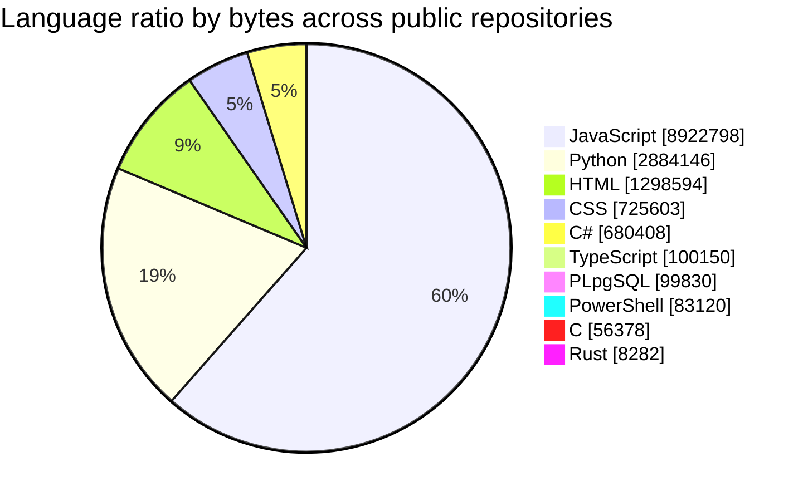
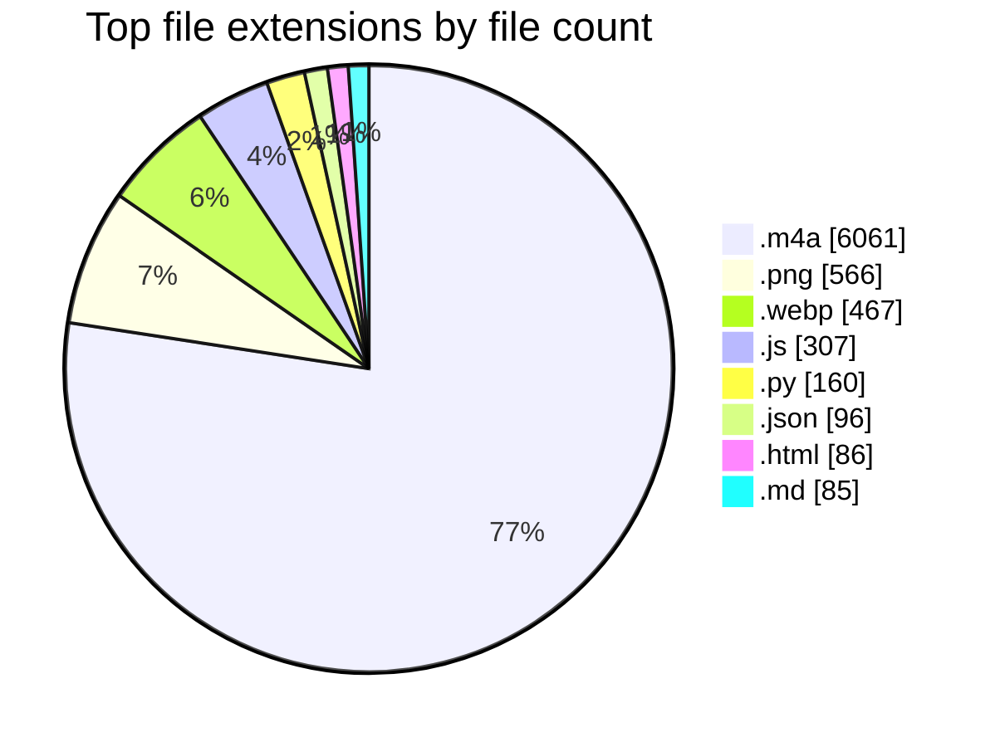

## Recent repositories

<table width="100%">
<tr><td align="center"></td></tr>
<tr><td align="center"></td></tr>
<tr><td align="center"></td></tr>
<tr><td align="center"></td></tr>
<tr><td align="center"></td></tr>
<tr><td align="center"></td></tr>
<tr><td align="center"></td></tr>
<tr><td align="center"></td></tr>
<tr><td align="center"></td></tr>
<tr><td align="center"></td></tr>
<tr><td align="center"></td></tr>
<tr><td align="center"></td></tr>
<tr><td align="center"></td></tr>
<tr><td align="center"></td></tr>
<tr><td align="center"></td></tr>
</table>

# 냥캣 (`tchinso`) GitHub Profile

> Last refreshed automatically: **2026-10-22 23:21 UTC**

## Language ratio across my repositories

언어 비율 표 보기 (접힘)

| Language | Bytes | Ratio |
| --- | ---: | ---: |
| JavaScript | 8,922,798 | 60.0% |
| Python | 2,884,146 | 19.4% |
| HTML | 1,298,594 | 8.7% |
| CSS | 725,603 | 4.9% |
| C# | 680,408 | 4.6% |
| TypeScript | 100,150 | 0.7% |
| PLpgSQL | 99,830 | 0.7% |
| PowerShell | 83,120 | 0.6% |
| C | 56,378 | 0.4% |
| Rust | 8,282 | 0.1% |

## Extension ranking

확장자 랭킹 표 보기 (접힘)

| Rank | Extension | Files |
| --- | --- | ---: |
| 1 | `.m4a` | 6,061 |
| 2 | `.png` | 566 |
| 3 | `.webp` | 467 |
| 4 | `.js` | 307 |
| 5 | `.py` | 160 |
| 6 | `.json` | 96 |
| 7 | `.html` | 86 |
| 8 | `.md` | 85 |
| 9 | `.svg` | 63 |
| 10 | `.gif` | 52 |
| 11 | `.glb` | 47 |
| 12 | `.sql` | 47 |
| 13 | `.cs` | 46 |
| 14 | `.css` | 36 |
| 15 | `.mjs` | 35 |
| 16 | `.gitignore` | 27 |
| 17 | `.txt` | 27 |
| 18 | `.jpg` | 17 |
| 19 | `.yml` | 15 |
| 20 | `.gitattributes` | 10 |
| 21 | `.cjs` | 10 |
| 22 | `.ico` | 9 |
| 23 | `.ps1` | 9 |
| 24 | `.csproj` | 9 |
| 25 | `.spec` | 8 |
| 26 | `.mp3` | 7 |
| 27 | `.woff2` | 6 |
| 28 | `.yaml` | 6 |
| 29 | `.wasm` | 5 |
| 30 | `.cfg` | 4 |

## GitHub Profile Summary

  

  
  

  
  

