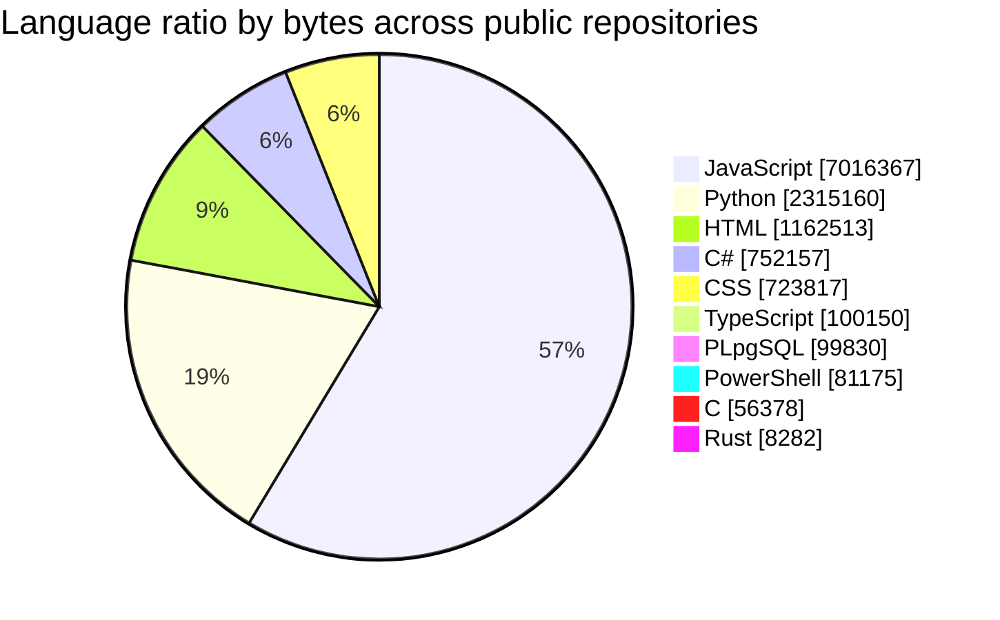
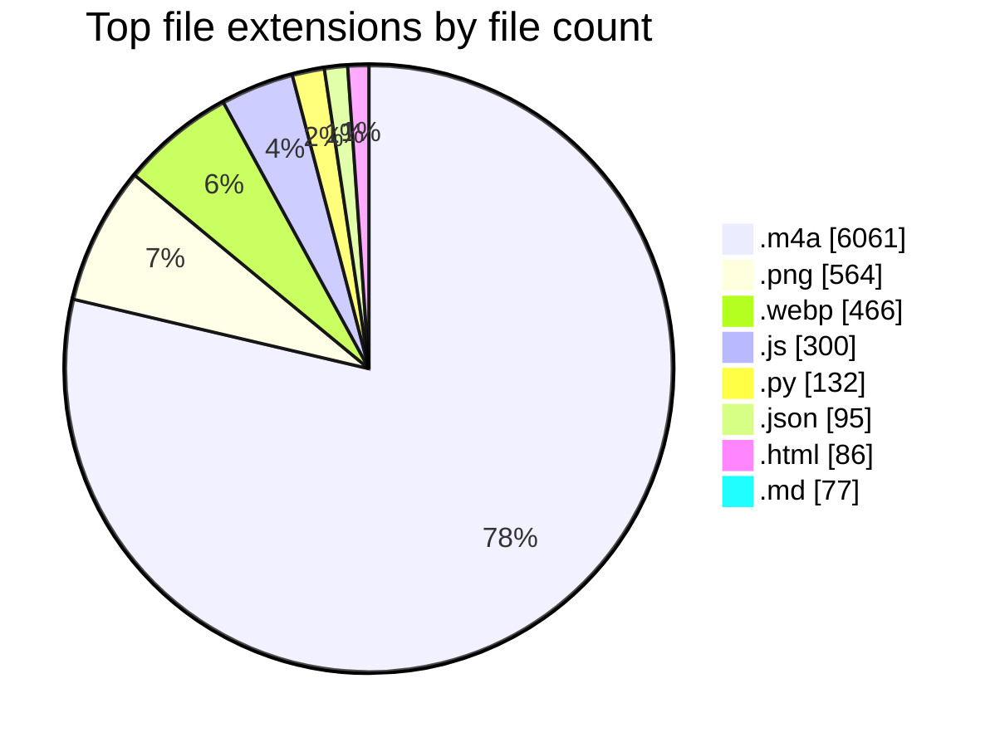

## Recent repositories

<table width="100%">
<tr><td align="center"></td></tr>
<tr><td align="center"></td></tr>
<tr><td align="center"></td></tr>
<tr><td align="center"></td></tr>
<tr><td align="center"></td></tr>
<tr><td align="center"></td></tr>
<tr><td align="center"></td></tr>
<tr><td align="center"></td></tr>
<tr><td align="center"></td></tr>
<tr><td align="center"></td></tr>
<tr><td align="center"></td></tr>
<tr><td align="center"></td></tr>
<tr><td align="center"></td></tr>
<tr><td align="center"></td></tr>
<tr><td align="center"></td></tr>
</table>

# 냥캣 (`tchinso`) GitHub Profile

> Last refreshed automatically: **2026-10-11 23:38 UTC**

## Language ratio across my repositories

언어 비율 표 보기 (접힘)

| Language | Bytes | Ratio |
| --- | ---: | ---: |
| JavaScript | 7,016,367 | 57.0% |
| Python | 2,315,160 | 18.8% |
| HTML | 1,162,513 | 9.4% |
| C# | 752,157 | 6.1% |
| CSS | 723,817 | 5.9% |
| TypeScript | 100,150 | 0.8% |
| PLpgSQL | 99,830 | 0.8% |
| PowerShell | 81,175 | 0.7% |
| C | 56,378 | 0.5% |
| Rust | 8,282 | 0.1% |

## Extension ranking

확장자 랭킹 표 보기 (접힘)

| Rank | Extension | Files |
| --- | --- | ---: |
| 1 | `.m4a` | 6,061 |
| 2 | `.png` | 564 |
| 3 | `.webp` | 466 |
| 4 | `.js` | 300 |
| 5 | `.py` | 132 |
| 6 | `.json` | 95 |
| 7 | `.html` | 86 |
| 8 | `.md` | 77 |
| 9 | `.svg` | 63 |
| 10 | `.gif` | 52 |
| 11 | `.cs` | 47 |
| 12 | `.sql` | 47 |
| 13 | `.glb` | 46 |
| 14 | `.css` | 38 |
| 15 | `.mjs` | 32 |
| 16 | `.txt` | 30 |
| 17 | `.gitignore` | 28 |
| 18 | `.jpg` | 17 |
| 19 | `.yml` | 15 |
| 20 | `.gitattributes` | 10 |
| 21 | `.ico` | 9 |
| 22 | `.ps1` | 9 |
| 23 | `.csproj` | 9 |
| 24 | `.spec` | 8 |
| 25 | `.cjs` | 7 |
| 26 | `.mp3` | 7 |
| 27 | `.woff2` | 6 |
| 28 | `.yaml` | 6 |
| 29 | `.wasm` | 5 |
| 30 | `.ttf` | 4 |

## GitHub Profile Summary

  

  
  

  
  

